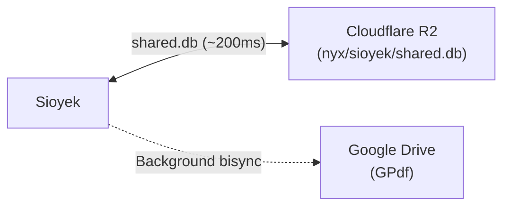

<div align="center">

# Sioyek Configuration

**Keyboard-driven PDF reader with Cloudflare R2 & Google Drive sync**

</div>

Personal Sioyek configuration for reading technical papers, textbooks, and university documents. Includes a Catppuccin Macchiato palette, keyboard-only highlight bindings, and a hybrid synchronization daemon between Cloudflare R2 and Google Drive.

## ✨ Features

- **⚡ Fast Annotation Sync** - `shared.db` (bookmarks, highlights, visual marks) syncs with Cloudflare R2 in ~200ms.
- **📁 PDF Library Bisync** - `~/Documents/GPdf` syncs bidirectionally with Google Drive via `rclone bisync`.
- **🚀 Instant Exit** - Uploads `shared.db` synchronously on close (~0.2s) and dispatches PDF sync to the background (`ASYNC_PDF_SYNC=1`).
- **⌨️ Keyboard-Only Highlights** - Highlights via visual mark ruler (`yh`) and smart word selection (`ah`), eliminating intrusive `f` hint overlays.
- **🔒 Data Safety & Smart SQLite Merge** - Automatic SQLite merge on divergence (bookmarks, highlights, reading positions) with PRAGMA integrity checks and bounded backups.
- **⏱️ Systemd Automation** - User timer (`sioyek-pdf-sync.timer`) runs every 30 min, and a shutdown service (`sioyek-sync-shutdown.service`) guards against data loss on power-off.
- **🖥️ Wayland / NVIDIA Safe** - Uses `QT_QPA_PLATFORM=xcb` to prevent EGL platform context error 3009 on NVIDIA drivers.

## 📁 Structure

```
sioyek/
├── keys_user.config                  # Keyboard shortcuts & vim-like navigation
├── prefs_user.config.tmpl            # Theme colors & dynamic shared.db path
├── README.md                         # This documentation
│
sioyek-sync/ (related components)
├── config.env                        # Remotes, paths, and timeout options
├── executable_sioyek-open            # URI scheme handler & smart launcher (~/.local/bin/sioyek-open)
├── executable_sioyek-sync            # Sync wrapper script (~/.local/bin/sioyek-sync)
├── executable_sioyek-translate       # Translation helper (~/.local/bin/sioyek-translate)
├── sioyek.desktop.tmpl               # Desktop entry (PDFs & x-scheme-handler/sioyek)
├── sioyek-sync-shutdown.service      # Systemd user service for clean shutdown push
├── sioyek-pdf-sync.service           # Systemd user service for background PDF sync
└── sioyek-pdf-sync.timer             # Systemd user timer (every 30m)
```

## ⌨️ Keybindings

| Key | Action | Description |
|-----|--------|-------------|
| `v` / `V` | Toggle visual ruler | Shows or hides the reading ruler line. |
| `j` / `k` | Move ruler | Moves the ruler up or down line by line. |
| `C-d` / `C-u` | Half-page scroll | Jumps half a screen while keeping reading context. |
| `yh` | **Highlight ruler line** | Highlights the line covered by the ruler without hint letters. |
| `yy` | Copy ruler text | Copies ruler-selected text to system clipboard. |
| `yc` | Copy portal text | Copies text from an active portal. |
| `ah` | Auto-highlight | Highlights the word or sentence under cursor. |
| `dh` | Delete highlight | Removes the highlight under the cursor. |
| `gy` | Select text | Enters manual mouse/cursor selection mode. |
| `ys` | Highlight search match | Highlights the current active search result (`/`). |
| `T` | Table of contents | Opens document table of contents outline. |
| `t` (o `tt`) | **Translate selection** | Translates selected text to Spanish via integrated popup and clipboard. |
| `yt` | **Translate ruler** | Translates the ruler-selected line via integrated popup and clipboard. |
| `gd` | Translate in DeepL | Opens selection in DeepL in the default browser. |
| `yd` | Ruler in DeepL | Opens ruler line in DeepL in the default browser. |
| `gt` | Translate in Google | Opens selection in Google Translate in the default browser. |
| `yT` | Ruler in Google | Opens ruler line in Google Translate in the default browser. |
| `q` | Close overlays | Closes open portals, overviews, or the visual ruler. |
| `ZZ` | Quit | Saves and exits Sioyek (vim style). |

## 🔄 Sync Architecture



- **Cloudflare R2 (`shared.db`):** S3-compatible, zero egress costs, ~200ms response time. Avoids the 3-5s API latency of Google Drive on launch and close.
- **Google Drive (`~/Documents/GPdf`):** Bidirectional sync with conflict-loser preservation and remote trash folder.
- **Locks:** POSIX `flock` separates database transfers (`TRANSFER_LOCK`) from PDF bisync (`PDF_LOCK`). Multiple instances hand off arguments without race conditions.

## 🚀 Setup on a New Machine

### 1. Dependencies

```bash
sudo pacman -S sioyek rclone sqlite zenity libnotify
```

### 2. Rclone Remotes (`~/.config/rclone/rclone.conf`)

```ini
[Cloudflare]
type = s3
provider = Cloudflare
access_key_id = <ACCESS_KEY_ID>
secret_access_key = <SECRET_ACCESS_KEY>
endpoint = https://<ACCOUNT_ID>.r2.cloudflarestorage.com
no_check_bucket = true

[Sioyek]
type = drive
scope = drive.file
```

> [!NOTE]
> `no_check_bucket = true` is required for Cloudflare R2 tokens scoped to a single bucket, preventing `403 Access Denied` on bucket creation checks.

### 3. Deploy & Enable Services

```bash
chezmoi apply
systemctl --user daemon-reload
systemctl --user enable --now sioyek-sync-shutdown.service
systemctl --user enable --now sioyek-pdf-sync.timer
```

## 🛠️ CLI Reference

The wrapper provides maintenance commands:

```bash
sioyek-sync --status     # Show local and remote hash status
sioyek-sync --pull       # Force pull shared.db from R2
sioyek-sync --push       # Force push shared.db to R2 and sync PDFs
sioyek-sync --pdfs       # Run only PDF folder bisync
sioyek-sync --dry-run    # Preview actions without touching disk or remotes
```
